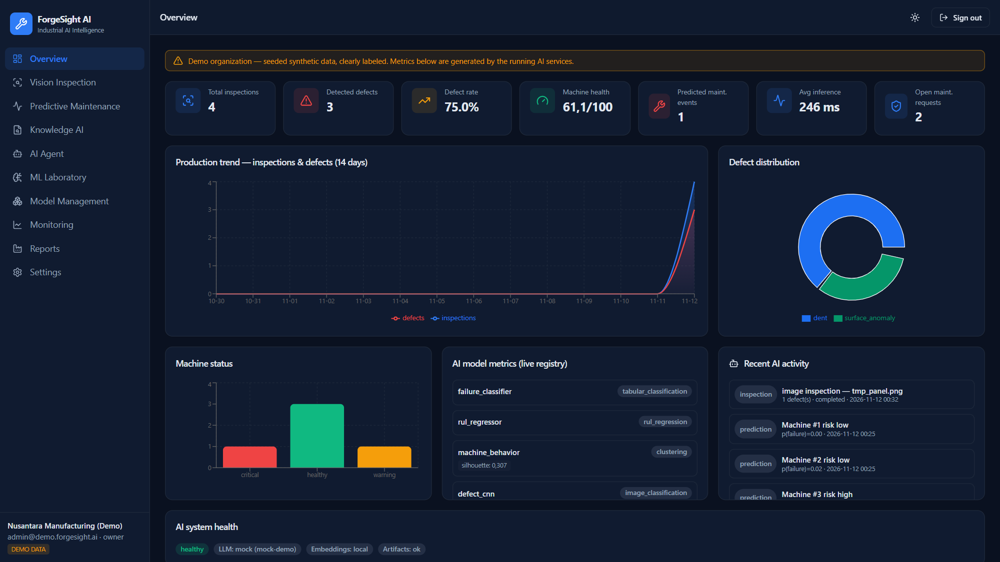
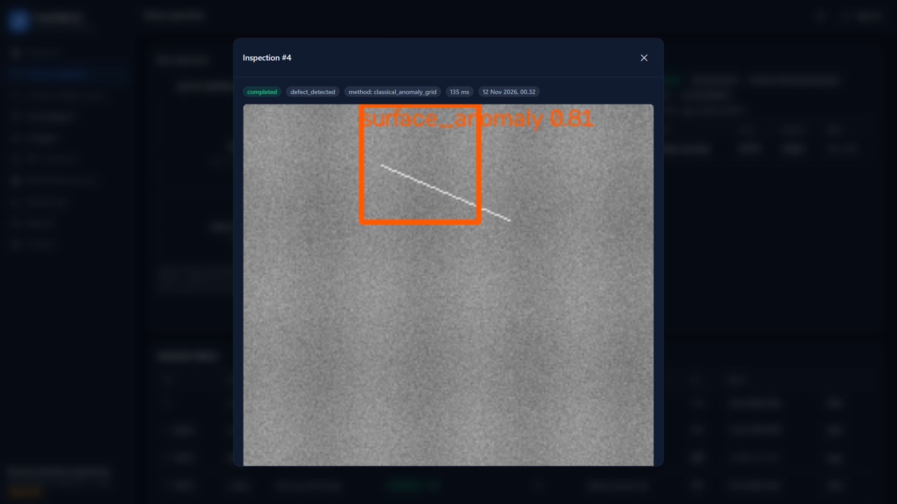
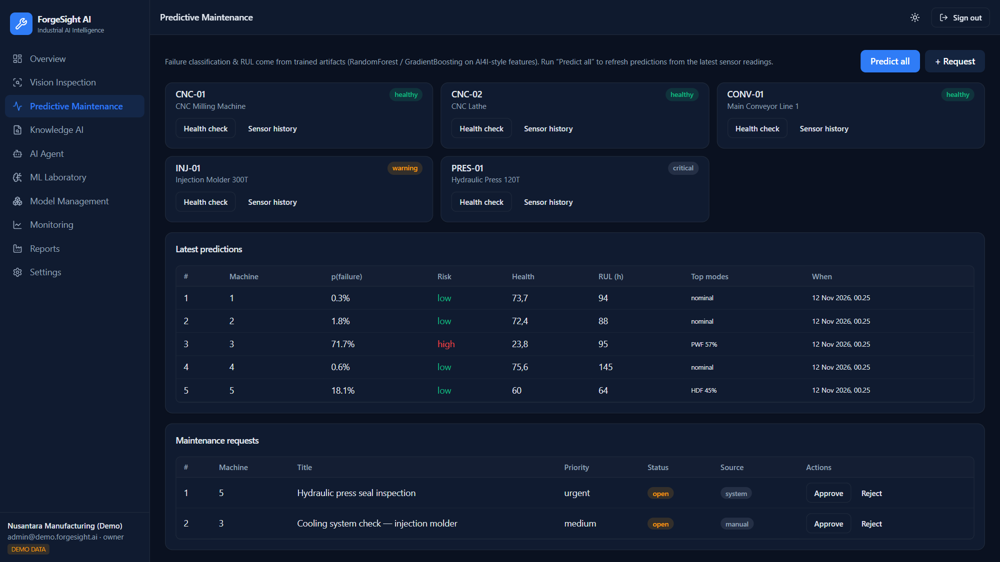
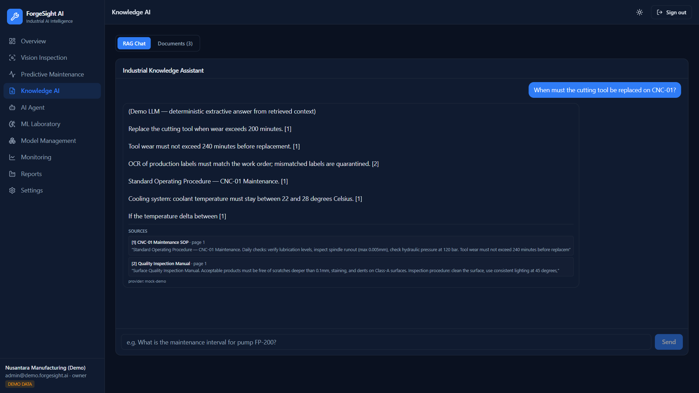
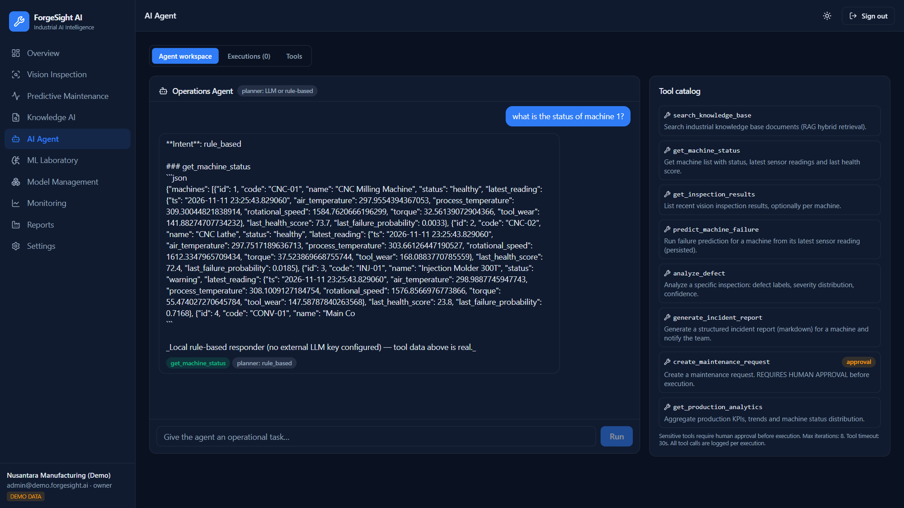
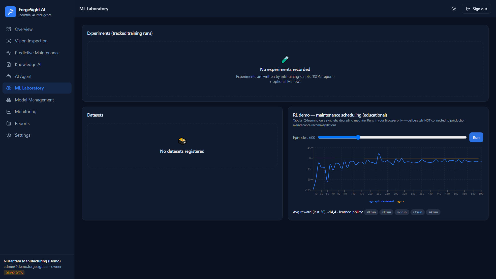
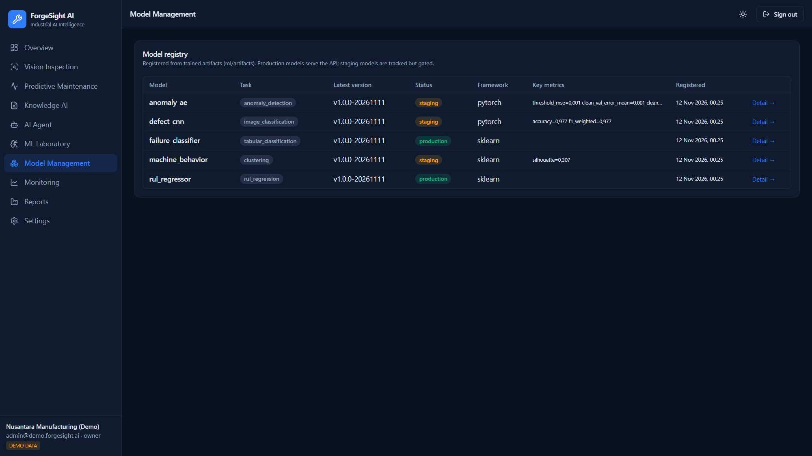
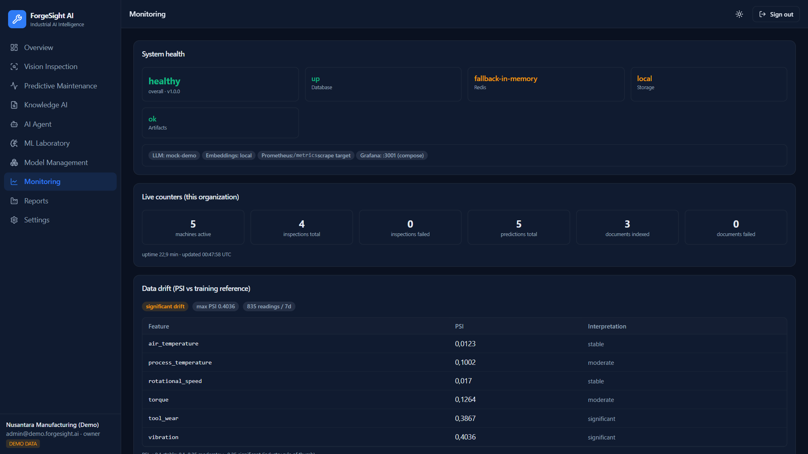
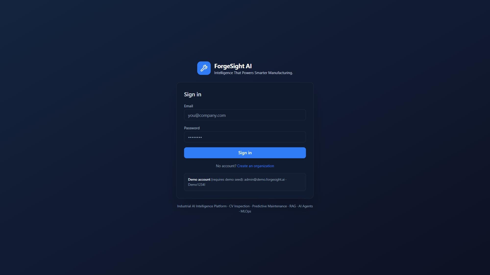
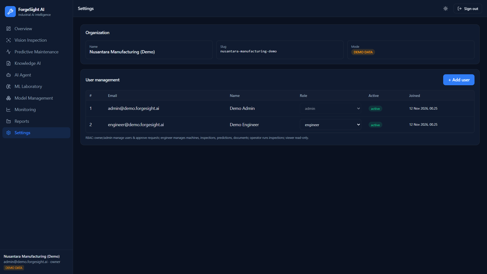

<div align="center">

# 🔧 ForgeSight AI

**Intelligence That Powers Smarter Manufacturing.**

Industrial AI Intelligence Platform — Computer Vision Inspection · Predictive
Maintenance · RAG Knowledge AI · Operations Agent · MLOps

`FastAPI` · `Next.js 16` · `PyTorch` · `scikit-learn` · `PostgreSQL+pgvector` ·
`Redis` · `MinIO` · `MLflow` · `Prometheus` · `Grafana` · `Docker`

</div>

---

## What is this?

ForgeSight AI is a **production-oriented AI engineering platform** for
manufacturing: it inspects products with computer vision, predicts machine
failures from sensor data, answers questions from industrial documents with
grounded RAG, and operates on all of it through a tool-calling AI agent with
human-in-the-loop approval — tracked end-to-end with an MLOps layer.

Every number in the UI comes from **real inference or real training** — no fake
model outputs. Where a capability needs an external key or binary (LLM
providers, YOLO weights, OCR), the platform runs a **clearly-labeled local
adapter** instead of pretending the integration is live.

## 📸 Screenshots

Captured from the running app (`docs/screenshots/`, regeneratable via
`scripts/take_screenshots.mjs`). Demo org is visibly labeled; every AI result
shows the exact method that produced it.

<table>
  <tr>
    <td width="50%"><br><b>Overview</b> — KPIs, 14-day production trend, defect distribution, machine status, live model metrics, AI system health</td>
    <td width="50%"><br><b>Vision inspection</b> — real OpenCV pipeline output: annotated defect localization with confidence + method labeling</td>
  </tr>
  <tr>
    <td><br><b>Predictive maintenance</b> — machine fleet, failure predictions (p(failure), health, RUL), approval-ready maintenance requests</td>
    <td><br><b>Knowledge AI</b> — grounded answers with numbered citations mapped to real document pages (provider labeled: mock-demo)</td>
  </tr>
  <tr>
    <td><br><b>AI Operations Agent</b> — tool-calling workspace with audit badges; sensitive tools (maintenance requests) require human approval</td>
    <td><br><b>ML Laboratory</b> — experiment browser + educational RL maintenance-scheduling simulation (isolated from production)</td>
  </tr>
  <tr>
    <td><br><b>Model Management</b> — registry seeded from trained artifacts (production/staging status, metrics)</td>
    <td><br><b>Monitoring</b> — system health, live counters, PSI data-drift report vs training reference</td>
  </tr>
  <tr>
    <td><br><b>Sign in</b> — themed dark/light auth, demo credentials hint</td>
    <td><br><b>Settings</b> — organization profile, RBAC user management</td>
  </tr>
</table>

*(also captured: `03-vision.png` inspection workspace, `11-reports.png` reports — see `docs/screenshots/`)*

## Modules

| Module | What it does | Key tech |
|---|---|---|
| **A · Dashboard** | KPIs, trends, defect distribution, model metrics, AI health — all from live data | Recharts, TanStack Query |
| **B · Vision Inspection** | Image/video defect detection, anomaly scoring, classification, OCR, annotated output | OpenCV, PyTorch CNN, autoencoder, YOLO (optional) |
| **C · Predictive Maintenance** | Failure classification, RUL regression, health score, failure-mode estimates, recommendations | scikit-learn/XGBoost, AI4I-style features |
| **D · Knowledge AI** | PDF/TXT/DOCX/CSV ingestion → chunking → embeddings → **hybrid search (vector+keyword, RRF)** → grounded answers with citations & injection defense | pgvector, FastAPI, provider-abstraction |
| **E · AI Operations Agent** | 8 tools (kb search, machine status, predict, incident report, **approval-gated** maintenance requests…), LangGraph-style state graph, execution audit trail | Pydantic structured tools, human-in-the-loop |
| **F · MLOps & Monitoring** | Model registry, experiment tracking (MLflow optional), PSI drift detection, Prometheus metrics, Grafana dashboards | MLflow, prometheus-client |
| **G · ML Laboratory** | Experiment browser + educational RL maintenance-scheduling sim (browser-only, isolated from production) | Client-side Q-learning |

## Quick start

### Option 1 — Docker Compose (full stack)

```bash
cp .env.example .env            # set SECRET_KEY!
docker compose up -d --build
# web →  http://localhost:3000
# api →  http://localhost:8000/docs
# grafana → http://localhost:3001 (admin/admin)
```

Demo credentials (auto-seeded, clearly labeled DEMO): `admin@demo.forgesight.ai` / `Demo1234!`

### Option 2 — Local development

```bash
# 1. Python backend
python -m venv .venv
.venv/Scripts/pip install -r services/api/requirements.txt          # core
.venv/Scripts/pip install -r services/api/requirements-ml.txt       # optional torch/xgboost

# 2. Train models (writes real artifacts + metrics)
bash scripts/train_all.sh

# 3. Run API (SQLite by default; set DATABASE_URL for Postgres)
cd services/api && uvicorn app.main:app --reload

# 4. Web
cd apps/web && npm install && npm run dev
```

Environment variables: see [`.env.example`](.env.example). All secrets are
env-injected; nothing is hardcoded.

## Repository layout

```
forsightai/
├── apps/web/               Next.js 16 + TS + Tailwind 4 + TanStack Query + Zustand + Recharts
├── services/api/           FastAPI monolith (modular routers per domain), Alembic migrations, tests
│   ├── app/api/v1/         REST endpoints (auth, vision, predictions, knowledge, agent, mlops…)
│   ├── app/services/       vision / pdm / knowledge / agent / mlops domain logic
│   ├── app/models/         20+ SQLAlchemy tables (orgs, machines, inspections, chunks, agent runs…)
│   └── tests/              49 pytest tests (auth, RBAC, tenants, pipelines, RAG, agent)
├── ml/
│   ├── training/           Reproducible training scripts (real runs, real metrics)
│   ├── datasets/           AI4I-style synthetic dataset + RUL trajectories (documented)
│   └── artifacts/          Trained models + metrics.json (source of truth for registry)
├── infrastructure/         Prometheus, Grafana provisioning, K8s templates
├── scripts/                train_all.sh, export_openapi.py
├── docs/                   Architecture, datasets, model cards, case study
└── docker-compose.yml      postgres+pgvector, redis, minio, api, web, mlflow, prometheus, grafana
```

## Honesty guarantees (read this)

- ✅ **Real training**: `ml/training/*` runs actual experiments and writes
  measured metrics — see `ml/artifacts/*/metrics.json` and
  [docs/model_cards](docs/model_cards).
- ✅ **Real inference**: the API loads those artifacts; when they are missing it
  returns `rules-only-fallback` with an explicit note, never a fake prediction.
- ✅ **Demo data labeled**: seeded org is `is_demo`, surfaced as a banner.
- ✅ **Mock LLM labeled**: without API keys the RAG/agent run a deterministic
  extractive adapter reported as `mock-demo`.
- ❌ **No claimed real-time camera** — camera streaming is not implemented in
  this build; the vision API is explicit about the methods it used.
- ❌ **No fabricated citations** — RAG refuses when retrieval is empty and maps
  every `[n]` to a real chunk (enforced by tests).

## Testing & CI

```bash
cd services/api && pytest          # 49 tests — auth, RBAC, cross-tenant, vision, RAG, agent, drift
cd apps/web && npm run build       # type-checked production build
```

GitHub Actions (`.github/workflows/ci.yml`): backend tests · ML training job
with artifact assertions · web build · Docker image builds.

## Documentation

- [Architecture](docs/architecture.md) — services, data flow, decisions
- [Datasets](docs/datasets.md) — sources, synthetic generation, limitations
- [Model cards](docs/model_cards/) — failure classifier, RUL, CNN, AE, clustering
- [Case study](docs/case_study.md) — business problem → results → limitations
- [PROJECT_STATUS](PROJECT_STATUS.md) — build log & remaining roadmap

## Security notes

JWT auth · role-based access control (owner/admin/engineer/operator/viewer) ·
organization-level tenant isolation (tested) · file type/size validation ·
prompt-injection hardening (delimiting + sentence-level sanitization, tested) ·
approval-gated destructive agent actions · audit logging · rate limiting ·
non-root containers.

> ⚠️ Demo credentials and seeded data are for local demonstration only.
> Change `SECRET_KEY`, DB passwords, and MinIO credentials before any real
> deployment.
